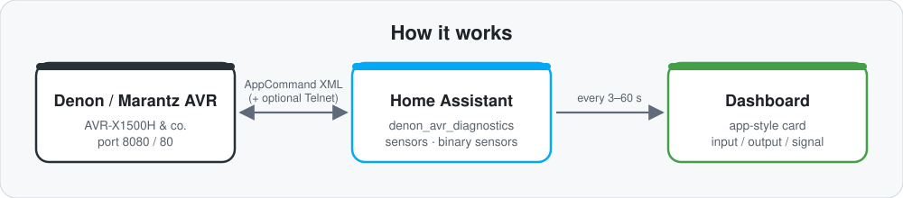
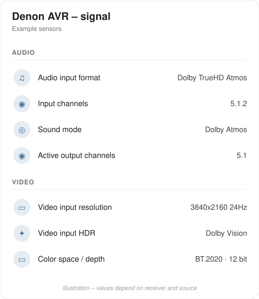
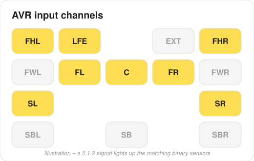

# Denon AVR Diagnostics für Home Assistant

[English](README.md) · **Deutsch**

[](https://hacs.xyz)


HACS-kompatible Integration, die die Audio- und Video-Signaldiagnose aus der Denon/Marantz-AVR-App als native Home-Assistant-Sensoren bereitstellt.

Entwickelt vor allem für den **Denon AVR-X1500H** und die AppCommand-Schnittstelle der Generation 2016, mit Feature-Erkennung und Fallbacks für verwandte moderne Denon- und Marantz-Netzwerk-Receiver.

Version 0.3.1 ist gegen Home Assistant 2026.8.1 mit Python 3.14 getestet.

> Diese Integration ergänzt den eingebauten Denon-AVR-Mediaplayer von Home Assistant. Sie nutzt die eigene Domain `denon_avr_diagnostics` und ersetzt die eingebaute Integration nicht.



## Was sie liefert

Je nachdem, was Receiver und aktuelle Quelle melden:

- Audio-Eingangsmodus, Eingangscodec/-format, Audioausgang und aktiver Klangmodus
- Abtastrate und Bitrate, sofern der Receiver sie liefert
- Kanalbelegung des Eingangs plus eigene Ein/Aus-Entitäten für FL, FR, C, LFE, Surround-, Back-, Wide- und Höhenkanäle
- Eingerichtete Lautsprecher und aktuell aktive Ausgangskanäle, ebenfalls als Ein/Aus-Entität pro Kanal
- Beschreibung der Video-/HDMI-Eingangs- und Ausgangssignale
- Auflösung und Bildrate von Ein- und Ausgang
- HDR10, HDR10+, Dolby Vision, HLG und allgemeine HDR-Kennungen
- Farbraum und Farbtiefe
- Video-Ausgang/Monitor-Informationen
- Modell, Hersteller, Firmware und Seriennummer als Gerätedaten
- Herunterladbare Home-Assistant-Diagnose mit ausgeblendetem Host und Seriennummer

Kanal-Zusammenfassungen haben vertraute Zustände wie `5.1` oder `5.1.2`. Zusätzlich gibt es Binärsensoren wie **Input channel FL**, **Input channel C**, **Active output channel FL** und **Active output channel LFE/SW**. Ihr Ein/Aus-Zustand lässt ein normales Home-Assistant-Raster jeden Kanal einzeln hervorheben – wie die Kanalmatrix in der Denon-App.

Die festen Eingangspositionen der Denon-App (FHL, LFE, EXT, FHR, FWL, FL, C, FR, FWR, SL, SR, SBL, SB und SBR) werden immer angelegt. Weitere Höhen- oder Dolby-Lautsprecher, die der Receiver meldet, kommen bei der Einrichtung dazu.

 

*Illustrationen – Beispielwerte; was du siehst, hängt von Receiver und Quelle ab.*

Nicht unterstützte Werte sind „nicht verfügbar“. Die Integration rät keinen Codec, Kanal oder Videowert, den der AVR nicht geliefert hat.

## Protokoll und Kompatibilität

Der Client probiert die lokalen HTTP-Schnittstellen des Receivers auf Port 8080 und 80. Er nutzt:

- `/goform/AppCommand0300.xml` für `GetAudioInfo`, `GetInputSignal`, `GetActiveSpeaker` und `GetVideoInfo`
- `/goform/AppCommand.xml` für Zone, Quelle und Surround-Zustand
- Das ältere Main-Zone-Status-XML als Fallback
- Optional Telnet-Abfragen des Denon-Steuerprotokolls (`PW?`, `SI?`, `MS?`) als einfacher Fallback

Die Denon-Firmware unterscheidet sich je nach Modell und Region stark. Die Endstufen-Zuweisung ist im Signalstatus des X1500H kein stabiles Feld; eingerichtete Lautsprecherkanäle erscheinen, sobald `GetActiveSpeaker` sie liefert. Auch die Bitrate gibt es nur bei Modellen/Firmware, die sie in der Audio-Antwort mitsenden.

Der Telnet-Fallback ist standardmäßig aus, weil manche Receiver nur einen Telnet-Client gleichzeitig erlauben.

## Installation mit HACS

1. HACS in Home Assistant öffnen.
2. **Integrationen** wählen.
3. Drei-Punkte-Menü → **Benutzerdefinierte Repositories**.
4. Hinzufügen: `https://github.com/dr-apple/ha-denon-avr-diagnostics`
5. Kategorie **Integration** wählen und hinzufügen.
6. **Denon AVR Diagnostics** installieren.
7. Home Assistant neu starten.
8. **Einstellungen → Geräte & Dienste → Integration hinzufügen**.
9. **Denon AVR Diagnostics** suchen und die lokale IP-Adresse oder den Hostnamen des Receivers eingeben.

Dem AVR am besten eine feste DHCP-Adresse geben.

## Optionen

Integration öffnen → **Konfigurieren**:

- Aktualisierungsintervall: 3–60 Sekunden (Standard: 5 Sekunden)
- Telnet-Fallback: standardmäßig aus

## Lovelace-Beispiele

Die Entity-IDs enthalten den Gerätenamen in Home Assistant. Die Beispiel-IDs unten durch die IDs deines Systems ersetzen.

### Komplette Karte im App-Stil mit Tabs

Im Repository liegt eine vollständige, kopierbare Karte im Denon-Stil mit den Tabs **Input**, **Output** und **Signal**:

- [Komplette Dashboard-Karte (YAML)](examples/denon-avr-dashboard-card.yaml)
- [Installation, nötige HACS-Karten und Entitäten-Zuordnung](examples/README.md)

Das Beispiel ist in sich geschlossen: Die 29 Kanal-Buttons enthalten ihre Styles direkt und brauchen keinen `button_card_templates`-Block im Dashboard. Die ganze Karte lässt sich also über den manuellen Karteneditor in ein anderes Dashboard kopieren.

### Eingangskanäle im Denon-Stil

Button-Karten mit Binärsensor nehmen automatisch die aktive Farbe an, solange ein Kanal anliegt. Das feste Raster folgt der Reihenfolge der Denon-AVR-Remote-App.

```yaml
type: grid
title: AVR input channels
columns: 4
square: false
cards:
  - type: button
    entity: binary_sensor.denon_avr_input_channel_fhl
    name: FHL
    show_state: false
  - type: button
    entity: binary_sensor.denon_avr_input_channel_lfe
    name: LFE
    show_state: false
  - type: button
    entity: binary_sensor.denon_avr_input_channel_ext
    name: EXT
    show_state: false
  - type: button
    entity: binary_sensor.denon_avr_input_channel_fhr
    name: FHR
    show_state: false
  - type: button
    entity: binary_sensor.denon_avr_input_channel_fwl
    name: FWL
    show_state: false
  - type: button
    entity: binary_sensor.denon_avr_input_channel_fl
    name: FL
    show_state: false
  - type: button
    entity: binary_sensor.denon_avr_input_channel_c
    name: C
    show_state: false
  - type: button
    entity: binary_sensor.denon_avr_input_channel_fr
    name: FR
    show_state: false
  - type: button
    entity: binary_sensor.denon_avr_input_channel_fwr
    name: FWR
    show_state: false
  - type: button
    entity: binary_sensor.denon_avr_input_channel_sl
    name: SL
    show_state: false
  - type: button
    entity: binary_sensor.denon_avr_input_channel_sr
    name: SR
    show_state: false
  - type: button
    entity: binary_sensor.denon_avr_input_channel_sbl
    name: SBL
    show_state: false
  - type: button
    entity: binary_sensor.denon_avr_input_channel_sb
    name: SB
    show_state: false
  - type: button
    entity: binary_sensor.denon_avr_input_channel_sbr
    name: SBR
    show_state: false
```

Raster duplizieren und `input_channel` durch `output_channel` ersetzen, um zu sehen, welche Lautsprecher der AVR gerade ansteuert. `configured_channel` zeigt die eingerichteten Lautsprecher.

### Signaldetails

```yaml
type: sections
max_columns: 3
sections:
  - type: grid
    cards:
      - type: heading
        heading: Audio input
        icon: mdi:audio-input-stereo-minijack
      - type: tile
        entity: sensor.denon_avr_audio_input_format
        grid_options:
          columns: 6
          rows: auto
      - type: tile
        entity: sensor.denon_avr_sampling_rate
        grid_options:
          columns: 6
          rows: auto
      - type: tile
        entity: sensor.denon_avr_input_channels
        grid_options:
          columns: 12
          rows: auto

  - type: grid
    cards:
      - type: heading
        heading: Processing and output
        icon: mdi:speaker-multiple
      - type: tile
        entity: sensor.denon_avr_sound_mode
        grid_options:
          columns: 6
          rows: auto
      - type: tile
        entity: sensor.denon_avr_audio_output_format
        grid_options:
          columns: 6
          rows: auto
      - type: tile
        entity: sensor.denon_avr_active_output_channels
        grid_options:
          columns: 6
          rows: auto
      - type: tile
        entity: sensor.denon_avr_configured_speakers
        grid_options:
          columns: 6
          rows: auto

  - type: grid
    cards:
      - type: heading
        heading: HDMI video
        icon: mdi:hdmi-port
      - type: tile
        entity: sensor.denon_avr_video_input_resolution
        grid_options:
          columns: 6
          rows: auto
      - type: tile
        entity: sensor.denon_avr_video_input_hdr
        grid_options:
          columns: 6
          rows: auto
      - type: tile
        entity: sensor.denon_avr_video_output_resolution
        grid_options:
          columns: 6
          rows: auto
      - type: tile
        entity: sensor.denon_avr_video_output_hdr
        grid_options:
          columns: 6
          rows: auto
      - type: entities
        entities:
          - sensor.denon_avr_hdmi_input_signal
          - sensor.denon_avr_hdmi_output_signal
          - sensor.denon_avr_video_input_color_space
          - sensor.denon_avr_video_input_color_depth
        grid_options:
          columns: 12
          rows: auto
```

## Beispiel-Automation

Licht auf eine Kinoszene dimmen, sobald ein Dolby-Vision- oder HDR10-Signal am AVR ankommt:

```yaml
triggers:
  - trigger: state
    entity_id: sensor.denon_avr_video_input_hdr
conditions:
  - condition: template
    value_template: >
      {{ trigger.to_state.state not in ['unknown', 'unavailable', 'SDR', 'Off', 'None'] }}
actions:
  - action: scene.turn_on
    target:
      entity_id: scene.movie
```

Die genauen Zustände deines Receivers vorher unter *Entwicklerwerkzeuge → Zustände* prüfen.

## Fehlersuche

- **Netzwerksteuerung** bzw. **IP Control** am AVR einschalten – auch für Standby, falls der Zugriff im Standby gebraucht wird.
- Receiver und Home Assistant müssen sich ohne Client-Isolation erreichen können.
- Ist ein einzelner Sensor nicht verfügbar, liefert die aktuelle Firmware oder Quelle diesen Wert evtl. nicht.
- Für Fehlerberichte: **Einstellungen → Geräte & Dienste → Denon AVR Diagnostics → Diagnose herunterladen**.
- Telnet-Fallback ausschalten, wenn schon eine andere Anwendung die Telnet-Verbindung des Receivers belegt.

## Technische Quellen

- [Denon AVR-X1500H Handbuch: Klangmodi und Kanalausgabe](https://manuals.denon.com/AVRX1500H/NA/EN/GFNFSYrvfbzbgs.php)
- [Denon AVR Control Protocol (offizielles PDF)](https://downloads.denon.com/documentmaster/us/avr-2308ciserialprotocol_ver540.pdf)
- [Etablierte Python-Bibliothek `denonavr` und mitgeschnittener X1500H-AppCommand-Verkehr](https://github.com/ol-iver/denonavr)
- [Dateistruktur von Home-Assistant-Integrationen](https://developers.home-assistant.io/docs/creating_integration_file_structure/)
- [Home-Assistant-Richtlinie zur Diagnose](https://developers.home-assistant.io/docs/core/integration-quality-scale/rules/diagnostics/)

Die AppCommand-Endpunkte sind lokale, nicht authentifizierte Schnittstellen, die Denons eigene AVR-Apps nutzen, für die es aber keine vollständige öffentliche Spezifikation gibt. Deshalb behandelt das Projekt jeden Detailbefehl als optional.

## Entwicklung

Den eigenständigen Protokoll-Parser prüfen:

```bash
python -m pytest -q
```

Python und JSON ohne installiertes Home Assistant prüfen:

```bash
python -m compileall -q custom_components tests
python -m json.tool custom_components/denon_avr_diagnostics/manifest.json >/dev/null
python -m json.tool custom_components/denon_avr_diagnostics/translations/en.json >/dev/null
```

## Lizenz

MIT
